<h1 align="center">Hola 👋, soy Luis</h1> <h3 align="center">Ingeniero Civil en Informática · Full Stack Developer desde Chile 🇨🇱</h3> 
  
 
 <h3>🙋‍♂️ Sobre mí</h3> <ul> <li>🎓 Titulado de la <b>PUCV</b> — Ingeniería Civil en Informática</li> <li>⚙️ Full stack, con foco fuerte en <b>backend</b></li> <li>🌱 Actualmente profundizando en arquitectura y cloud</li> <li>🌎 Español nativo · Inglés B2 · Portugués B1</li> <li>📍 Valparaíso / Santiago, Chile</li> </ul> 
 <h3>🤝 Conéctate conmigo</h3> 
   
 
 <h3>🧠 Stack y experiencia</h3> <table> <tr> <th></th> <th align="left">Tecnología</th> <th align="left">Nivel</th> <th align="left"></th> <th align="left">Años</th> </tr> <tr><td colspan="5"><b>💻 Lenguajes</b></td></tr> <tr> <td></td> <td>TypeScript</td> <td></td> <td></td> <td>4</td> </tr> <tr> <td></td> <td>JavaScript</td> <td></td> <td></td> <td>4</td> </tr> <tr> <td></td> <td>Python</td> <td></td> <td></td> <td>4</td> </tr> <tr><td colspan="5"><b>⚙️ Backend</b></td></tr> <tr> <td></td> <td>Node.js</td> <td></td> <td></td> <td>4</td> </tr> <tr> <td></td> <td>Django</td> <td></td> <td></td> <td>4</td> </tr> <tr> <td></td> <td>NestJS</td> <td></td> <td></td> <td>1</td> </tr> <tr><td colspan="5"><b>🎨 Frontend</b></td></tr> <tr> <td></td> <td>React</td> <td></td> <td></td> <td>3</td> </tr> <tr> <td></td> <td>Next.js</td> <td></td> <td></td> <td>1</td> </tr> <tr><td colspan="5"><b>🗄️ Bases de datos y ORMs</b></td></tr> <tr> <td></td> <td>PostgreSQL</td> <td></td> <td></td> <td>2</td> </tr> <tr> <td></td> <td>MySQL</td> <td></td> <td></td> <td>2</td> </tr> <tr> <td></td> <td>Prisma</td> <td></td> <td></td> <td>1</td> </tr> <tr> <td></td> <td>SQL Server</td> <td></td> <td></td> <td>1</td> </tr> <tr><td colspan="5"><b>☁️ DevOps y Cloud</b></td></tr> <tr> <td></td> <td>Docker</td> <td></td> <td></td> <td>4</td> </tr> <tr> <td></td> <td>AWS</td> <td></td> <td></td> <td>2</td> </tr> <tr> <td></td> <td>Azure</td> <td></td> <td></td> <td>1</td> </tr> <tr> <td></td> <td>Vercel</td> <td></td> <td></td> <td>1</td> </tr> </table> <h3>🛠️ Otras herramientas</h3> 
  
 
 <h3>📊 Estadísticas</h3> 
   
 
  

